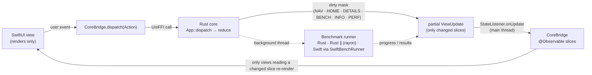

# MasterFabric · Swift + Rust (iOS)

A shared Rust core with a native SwiftUI UI. State, navigation, data, business rules and
benchmark orchestration live in Rust (`crates/app-core`), exposed to Swift through UniFFI
(`crates/app-ffi`). SwiftUI only renders and forwards user events.

## Flow



1. A SwiftUI view sends an `Action` (`OpenDetail`, `Back`, `PopTo`, `SetQuery`, `ToggleFavorite`,
   `OpenBenchmark`, `OpenInfo`, `RunBenchmark`, `RunAllBenchmarks`, `ResetBenchmarks`, `RecordPerf`).
2. `App::dispatch` reduces it into `AppState` and returns a dirty mask; no-op actions
   (same query, navigating to the current route, an impossible pop) emit nothing.
3. Only the dirty slices are built into a `ViewUpdate` and sent through `StateListener`.
4. `CoreBridge` stores each slice in its own `@Observable` property, so a benchmark progress
   tick does not invalidate the Home list.
5. The navigation stack lives in Rust; `NavigationStack(path:)` is bound to the Rust stack keys.
   Swipe-back / Back sends `PopTo` to Rust.

## Layout

| Path | What |
|---|---|
| `crates/app-core` | Rust core: `app.rs` (dispatch, dirty mask, ViewUpdate), `navigation.rs`, `screens/` (home, detail, benchmark, info view models), `store/`, `workloads.rs` + `media.rs` (benchmarks) |
| `crates/app-ffi` | UniFFI records/enums/objects (`AppCore`, `StateListener`, `SwiftBenchRunner`) |
| `crates/uniffi-bindgen` | bindgen binary (library mode) |
| `platforms/ios/project.yml` | XcodeGen spec (the `.xcodeproj`, `Generated/` and the xcframework are build output, gitignored) |
| `platforms/ios/MasterFabricRust` | SwiftUI app: `Bridge/` (CoreBridge, Perf, DeviceInfo), `Screens/`, `Benchmarks/` (Swift ports), `Brand/` (wordmark, Swift + Rust hero), `Assets.xcassets` |
| `scripts/` | `build-ios.sh`, `run-sim.sh`, `measure.sh`, `perf_summary.py` |

## Screens
- **Home**: MASTERFABRIC textmark + "Swift + Rust = boom" hero, live Rust state revision,
  searchable project list (search/sort/favorites in Rust). The navigation title is hidden.
- **Detail**: item detail, favorite toggle, related items (Rust `DetailViewModel`).
- **Benchmark**: Rust vs Swift, same algorithm and data, checksums compared. Media first,
  ray-trace output rendered from the Rust RGBA buffer next to the Swift one, results table,
  Swift Charts (ratio + duration), app performance card (launch, dispatch→apply, dispatch→frame).
- **Info**: what you can build with Rust, architecture diagram, ratios measured by this app only,
  app performance. All content is served from Rust.

## Benchmarks
| Category | Test | Size | Rust ∥ (rayon) |
|---|---|---|---|
| Media | Ray tracing: 4 spheres + floor, shadows, 2 reflections, 4 spp | 256 × 256 | ✓ |
| Media | Triangle rasterization with z-buffer | 3,000 triangles, 512 × 512 | ✓ |
| Media | Image: gaussian blur → bilinear resize → color LUT → RGB→YUV | 1024² → 512² | ✓ |
| Media | Video: YUV + blur + frame diff + 16×16 block motion estimation | 30 frames 640×360 | ✓ |
| Media | 3D mesh: icosphere + displacement + normals + OBJ export | 5 levels, 20,480 tris | – |
| General | Fibonacci (recursion) | n = 30 | – |
| General | Sort integers (xorshift input) | 1,000,000 | ✓ |
| General | SHA-256, hand-written in both languages | 1 MiB | – |
| General | JSON encode + decode (serde_json vs Codable) | 5,000 records | – |
| General | Prime sieve, matrix multiply, HashMap counting | | matmul ✓ |

Each test: 1 warm-up + N measured runs on a background thread. Ratio = Swift avg / Rust
single-thread avg. Rayon variants reuse the same row/band kernels (identical checksums) and are
shown separately, never mixed into the ratio. Swift has no parallel variants.

## Performance work
- `[profile.release]`: `opt-level=3`, `lto="fat"`, `codegen-units=1`, `panic="abort"`, `strip=true`.
  Trade-off: with `panic="abort"` a Rust panic aborts the process instead of being turned into a
  Swift error by UniFFI's `catch_unwind`.
- `.cargo/config.toml`: `target-cpu=apple-m1` for the simulator, `apple-a14` for devices.
  The Swift side is not CPU-tuned the same way, so this slightly favours Rust.
- FFI: partial `ViewUpdate`s instead of a full state snapshot per change; large buffers
  (ray-trace image) cross once as `Vec<u8>`.
- Hot loops: slice/zip iteration, `as_chunks`, no allocations inside loops.
- Measured in-app and recorded into Rust via `Action::RecordPerf`: launch → first frame,
  Rust core init, dispatch → state applied (avg/p95), full snapshot cost, dispatch → next frame.

## Build & run
Prerequisites: Xcode, `rustup target add aarch64-apple-ios aarch64-apple-ios-sim`, `brew install xcodegen`.

```sh
./scripts/build-ios.sh        # Rust release (device + sim) + host dylib, UniFFI Swift bindings, xcframework, xcodegen
./scripts/run-sim.sh          # build (Release), install and launch on the booted simulator (else boots "iPhone 18 Pro")
./scripts/measure.sh after 3  # 3 launches with -probe/-autorun, medians of build/perf/after-*.json
cargo test --release && cargo clippy --workspace --all-targets --release
```

Launch arguments (pass after `run-sim.sh` or `simctl launch`):

| Argument | Effect |
|---|---|
| `-startScreen home\|detail\|benchmark\|info` | open a screen at launch |
| `-detailId N` | item for `-startScreen detail` (default 1) |
| `-query text` | initial search query |
| `-autorun YES` | run all benchmarks |
| `-probe YES` | measure dispatch→apply and dispatch→frame latency before autorun |
| `-scrollTo media\|table\|charts\|perf\|<bench id>` | benchmark screen: scroll there when a run finishes |
| `-infoScrollTo projects\|measured\|perf` | info screen: scroll there on appear |

`measure.sh` writes `Documents/perf.json` from the app and copies it to `build/perf/<label>-<i>.json`.
Simulator numbers measure the Mac CPU, not an iPhone; measure on AC power.

## Brand assets
- MASTERFABRIC textmark: drawn as text exactly like the MasterFabric ecomm app
  (`BrandHeaderView`: body/medium, tracking 6).
- App icon: `AppIcon-Wordmark-Black` from the ecomm app (single 1024 universal PNG).
- Rust logo: `rust-logo-single-path.svg` from [rust-lang/rust-artwork](https://github.com/rust-lang/rust-artwork),
  © the Rust project, [CC-BY 4.0](https://creativecommons.org/licenses/by/4.0/). Only the SVG
  width/height were changed (mm → points); rendered as a template vector. The Rust name and logo
  are trademarks of the Rust Foundation. Swift logo: SF Symbol `swift`.
