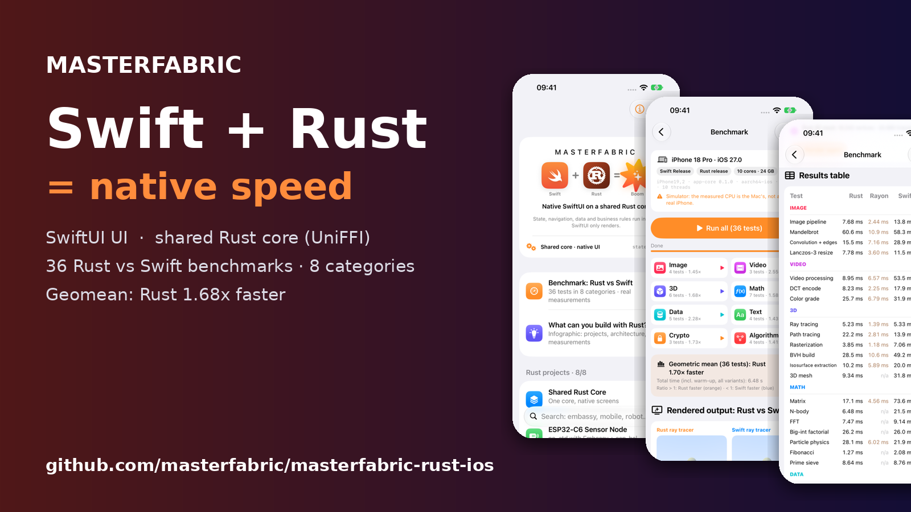
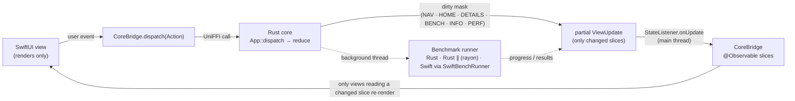
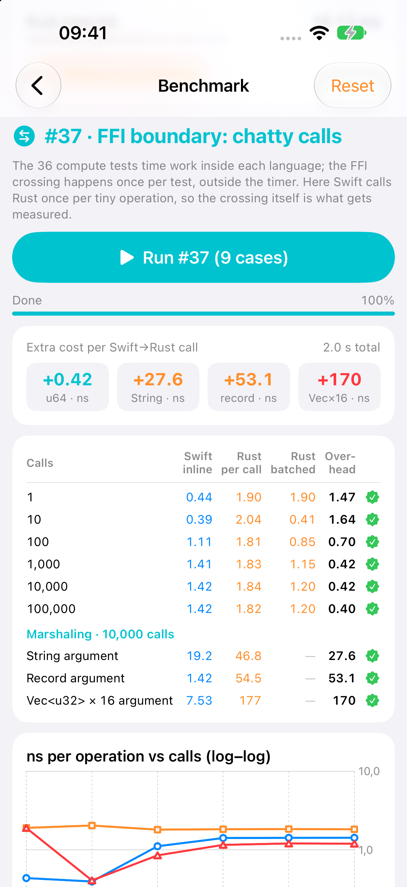

<p align="center"></p>

# MasterFabric · Swift + Rust (iOS)

A shared Rust core with a native SwiftUI UI. State, navigation, data, business rules and
benchmark orchestration live in Rust (`crates/app-core`), exposed to Swift through UniFFI
(`crates/app-ffi`). SwiftUI only renders and forwards user events.

## Flow



1. A SwiftUI view sends an `Action` (`OpenDetail`, `Back`, `PopTo`, `SetQuery`, `ToggleFavorite`,
   `OpenBenchmark`, `OpenInfo`, `RunBenchmark`, `RunAllBenchmarks`, `ResetBenchmarks`, `RecordPerf`).
2. `App::dispatch` reduces it into `AppState` and returns a dirty mask; no-op actions
   (same query, navigating to the current route, an impossible pop) emit nothing.
3. Only the dirty slices are built into a `ViewUpdate` and sent through `StateListener`.
4. `CoreBridge` stores each slice in its own `@Observable` property, so a benchmark progress
   tick does not invalidate the Home list.
5. The navigation stack lives in Rust; `NavigationStack(path:)` is bound to the Rust stack keys.
   Swipe-back / Back sends `PopTo` to Rust.

## Layout

| Path | What |
|---|---|
| `crates/app-core` | Rust core: `app.rs` (dispatch, dirty mask, ViewUpdate), `navigation.rs`, `screens/` (home, detail, benchmark, info view models), `store/`, `workloads.rs` + `media.rs` + `heavy.rs` (36 benchmark kernels), `ffi_bench.rs` (test #37: FFI boundary cases + analysis), `examples/calibrate.rs` |
| `crates/app-ffi` | UniFFI records/enums/objects (`AppCore`, `StateListener`, `SwiftBenchRunner`) + the deliberately tiny `ffi_*` functions of test #37 |
| `crates/uniffi-bindgen` | bindgen binary (library mode) |
| `platforms/ios/project.yml` | XcodeGen spec (the `.xcodeproj`, `Generated/` and the xcframework are build output, gitignored) |
| `platforms/ios/MasterFabricRust` | SwiftUI app: `Bridge/` (CoreBridge, Perf, DeviceInfo), `Screens/`, `Benchmarks/` (Swift ports, `SwiftHeavy.swift`), `Brand/` (wordmark, Swift + Rust hero), `Assets.xcassets` |
| `platforms/ios/MasterFabricRustUITests` | XCUITest flow tests (Home → Detail → Benchmark → Info → back, favorite round trip, springboard icon) |
| `scripts/` | `build-ios.sh`, `run-sim.sh`, `measure.sh`, `perf_summary.py`, `crosscheck.sh` |

## Screens
- **Home**: MASTERFABRIC textmark + "Swift + Rust = boom" hero, live Rust state revision,
  searchable project list (search/sort/favorites in Rust). The navigation title is hidden.
- **Detail**: item detail, favorite toggle, related items (Rust `DetailViewModel`).
- **Benchmark**: 36 Rust vs Swift tests in 8 categories, same algorithm and data, checksums compared.
  "Run all" plus a per-category run grid (`RunCategory` action), overall geomean, ray-trace output
  rendered from the Rust RGBA buffer next to the Swift one, results table grouped by category,
  Swift Charts (ratio + duration per category), per-category cards with a Run button, and an app
  performance card (launch, dispatch→apply, dispatch→frame). Runs happen on a background thread.
  A separate **#37 FFI boundary** section measures what chatty Swift→Rust calls cost (see below).
- **Info**: what you can build with Rust, architecture diagram, ratios measured by this app only,
  app performance. All content is served from Rust.

## Benchmarks
36 tests in 8 categories. Each has a Rust implementation (`app-core`) and a Swift twin
(`Benchmarks/`); both use the same input generator (XorShift32) and must produce the same checksum.
✓ = has a Rust rayon variant.

| Category | Tests (size) |
|---|---|
| Image | image pipeline: blur → bilinear 512² → LUT → YUV (1024²) ✓ · Mandelbrot, 256 iterations (768²) ✓ · 5×5 gaussian + 3×3 Sobel (1536²) ✓ · Lanczos-3 resize (1024² → 768²) ✓ |
| Video | YUV + blur + frame diff + motion estimation (30 × 640×360) ✓ · 8×8 DCT-II + JPEG quantization (16 frames) ✓ · color grade: gamma LUT, saturation, vignette, histogram (8 × 720p) ✓ |
| 3D | ray tracing (256², 4 spp) ✓ · path tracing, 8 spp, 4 bounces (160²) ✓ · z-buffer rasterization (3,000 tris) ✓ · BVH build, median split (50,000 tris) ✓ · isosurface via surface nets over 3 metaballs (128³) ✓ · icosphere mesh + OBJ export (20,480 tris) |
| Math | matrix multiply (512²) ✓ · 5-body N-body (300,000 steps) · radix-2 FFT (2¹⁸) · big-int factorial (10,000!) · particle physics (200,000 × 50 steps) ✓ · Fibonacci (30) · prime sieve (5,000,000) |
| Data | sort (1,000,000 u32) ✓ · JSON encode + decode (serde_json vs Codable, 5,000 records) · HashMap counting (300,000) · k-means, k = 16 (200,000 points) ✓ · LZ77 compression (1 MiB) ✓ |
| Text | word frequency (2 MiB) · regex-like search, 5 patterns (1 MiB) ✓ · string sort (200,000) ✓ · Levenshtein (8 pairs × 1,600 chars) ✓ |
| Crypto | SHA-256, hand-written, no CryptoKit (4 MiB) · ChaCha20, RFC 8439 (4 MiB) ✓ · CRC-32 table-driven (8 MiB) |
| Algorithms | Dijkstra, binary heap (512² grid) · BFS, CSR (300k nodes, 1.2M edges) · N-Queens (13) ✓ · Sudoku backtracking (160 puzzles) ✓ |

Each test: 1 warm-up + N measured runs on a background thread. Ratio = Swift avg / Rust
single-thread avg; the screen also shows the geomean overall and per category. Rayon variants
reuse the same kernels (identical checksums) and are shown separately, never mixed into the ratio.
Swift has no parallel variants. Floating-point sums are quantized per item before summing, so
checksums are order-independent (sequential = parallel = Swift).

### What the 36 timings include (and exclude)
- **Rust** is timed inside Rust: `workloads::measure_with` wraps each `run_once` in `Instant::now()`
  (`crates/app-core/src/workloads.rs`), on Rust's own background thread (`App::run_benchmarks`).
- **Swift** is timed inside Swift: `SwiftWorkloads.measure` wraps each `runOnce` in
  `DispatchTime.now()` (`Benchmarks/SwiftWorkloads.swift`). Rust reaches it through *one*
  `SwiftBenchRunner.run` callback per test (`app-ffi` `RunnerAdapter`).
- So the UniFFI crossing (one per test, either direction) is **outside both timers**: the 36 ratios
  compare compute only, which is fair for coarse-grained calls. Inputs are generated inside each
  kernel, so no data is marshaled per test either. The `dispatch → state applied` metric (App
  performance card) is the only number that includes FFI + UI-update cost.
- What the 36 tests do *not* tell you is what happens when Swift calls Rust many times with tiny
  amounts of work. That is test #37.

### #37 · FFI boundary: chatty calls (own section, not one of the 8 categories)
The same tiny op (`mix`: multiply, xor, rotate ≈ 1.4 ns) is executed `N` times
(N = 1, 10, 100, 1k, 10k, 100k) in three ways:

| Variant | What crosses the boundary |
|---|---|
| Swift inline | nothing (baseline, pure Swift loop) |
| Rust per call | one UniFFI call `ffiMix(acc:i:)` per op |
| Rust batched | one UniFFI call `ffiMixBatch(seed:n:)` that loops N times in Rust |

Plus three **marshaling** cases at 10,000 calls that pass a `String` (~20 bytes), a 3×`i32`
record and a `Vec<u32>` of 16 on every call. Every sample runs ≈ 1,000,000 ops
(`reps = 1,000,000 / N`, each rep seeded `0x5EED ^ rep` so nothing can be hoisted), 1 warm-up +
5 timed samples, median ns/op. Timing happens on the Swift side (only the caller can see the
crossing), but cases, parameters, order, the per-row verdicts and the crossover analysis live in
Rust (`crates/app-core/src/ffi_bench.rs`, `Action::RunFfiBench`, partial `ViewUpdate`). All
variants must produce Rust's `reference_checksum`.

Results (iPhone 18 Pro **simulator → Mac CPU**, Release, median of 3 app runs):

| Case | Calls | Swift inline | Rust per call | Rust batched | Extra per call |
|---|---:|---:|---:|---:|---:|
| u64 | 1 | 0.43 | 1.90 | 1.90 | 1.48 |
| u64 | 10 | 0.38 | 1.99 | 0.45 | 1.62 |
| u64 | 100 | 1.11 | 1.81 | 0.85 | 0.70 |
| u64 | 1,000 | 1.41 | 1.83 | 1.15 | 0.42 |
| u64 | 10,000 | 1.42 | 1.84 | 1.20 | 0.42 |
| u64 | 100,000 | 1.42 | 1.84 | 1.20 | 0.42 |
| String arg | 10,000 | 19.2 | 50.2 | — | 31 |
| record arg | 10,000 | 1.45 | 54.5 | — | 53 |
| Vec\<u32\>×16 arg | 10,000 | 7.76 | 177 | — | 170 |

ns per operation. Takeaways:
- **Scalar calls are cheap**: a `u64 → u64` UniFFI call costs ≈ 1.8–1.9 ns end to end. In a
  dependent chain it adds ≈ 0.4 ns over inline Swift; for independent tiny work (N ≤ 10) it is
  ≈ 4–5× slower than inline Swift.
- **Marshaling is the real cost**: anything UniFFI serializes into a `RustBuffer` (String, record,
  Vec) adds ≈ 30–170 ns *per call*, i.e. 25–120× the work in these cases.
- **Batching wins**: one call doing N ops pays the crossing once and runs ≈ 1.2× faster than
  inline Swift from N ≈ 100.
- **Break-even**: with Rust ≈ 1.7× faster at compute (geomean of the 36 tests), a call must carry
  ≥ ~1 ns of Swift-time work with scalar args, and ≥ ~0.4 µs with a Vec/record arg, before moving
  it to Rust pays off. That is why this app sends one `Action` per user event and one partial
  `ViewUpdate` back instead of per-item calls.



Verification outside the app:

```sh
cargo test --release                                   # includes every_benchmark_runs_and_parallel_matches + known answers (RFC 8439 block, ...)
cargo run --release -p app-core --example calibrate    # per-test ms, parallel ms and checksum on the host
./scripts/crosscheck.sh                                # builds the Swift workloads with swiftc -O for the host and compares all 36 checksums with Rust
```

## Performance work
- `[profile.release]`: `opt-level=3`, `lto="fat"`, `codegen-units=1`, `panic="abort"`, `strip=true`.
  Trade-off: with `panic="abort"` a Rust panic aborts the process instead of being turned into a
  Swift error by UniFFI's `catch_unwind`.
- `.cargo/config.toml`: `target-cpu=apple-m1` for the simulator, `apple-a14` for devices.
  The Swift side is not CPU-tuned the same way, so this slightly favours Rust.
- FFI: partial `ViewUpdate`s instead of a full state snapshot per change; large buffers
  (ray-trace image) cross once as `Vec<u8>`. Test #37 quantifies why: per-call marshaling costs
  30–170 ns, so the app never makes per-item calls.
- Hot loops: slice/zip iteration, `as_chunks`, no allocations inside loops.
- Measured in-app and recorded into Rust via `Action::RecordPerf`: launch → first frame,
  Rust core init, dispatch → state applied (avg/p95), full snapshot cost, dispatch → next frame.

## Build & run
Prerequisites: Xcode, `rustup target add aarch64-apple-ios aarch64-apple-ios-sim`, `brew install xcodegen`.

```sh
./scripts/build-ios.sh        # Rust release (device + sim) + host dylib, UniFFI Swift bindings, xcframework, xcodegen
./scripts/run-sim.sh          # build (Release), install and launch on the booted simulator (else boots "iPhone 18 Pro")
# UI flow tests (scheme MasterFabricRust, Debug):
# xcodebuild test -project platforms/ios/MasterFabricRust.xcodeproj -scheme MasterFabricRust -destination 'platform=iOS Simulator,name=iPhone 18 Pro'
./scripts/measure.sh after 3  # 3 launches with -probe/-autorun, medians of build/perf/after-*.json
./scripts/measure-ffi.sh v1 3 # test #37 only: 3 launches with -ffiAutorun, median table of build/perf/ffi-v1-*.json
cargo test --release && cargo clippy --workspace --all-targets --release
```

Launch arguments (pass after `run-sim.sh` or `simctl launch`):

| Argument | Effect |
|---|---|
| `-startScreen home\|detail\|benchmark\|info` | open a screen at launch |
| `-detailId N` | item for `-startScreen detail` (default 1) |
| `-query text` | initial search query |
| `-autorun YES` | run all 36 benchmarks |
| `-ffiAutorun YES` | run test #37 (FFI boundary); with `-autorun YES` it runs after the 36, so break-even uses the measured geomean |
| `-probe YES` | measure dispatch→apply and dispatch→frame latency before autorun |
| `-scrollTo categories\|media\|table\|charts\|perf\|ffi\|ffi-table\|ffi-chart\|cat-<Category>\|<bench id>` | benchmark screen: scroll there when a run finishes |
| `-infoScrollTo projects\|measured\|perf` | info screen: scroll there on appear |

Bundle id: `com.masterfabric.rustios`, display name "MasterFabric Rust".
`measure.sh` prints the per-test table (Rust, rayon, Swift, ratio, checksum) and writes `Documents/perf.json` from the app and copies it to `build/perf/<label>-<i>.json`.
Simulator numbers measure the Mac CPU, not an iPhone; measure on AC power.

## Brand assets
- MASTERFABRIC textmark: drawn as text exactly like the MasterFabric ecomm app
  (`BrandHeaderView`: body/medium, tracking 6).
- App icon: `AppIcon-Wordmark-Black` from the ecomm app (single 1024 universal PNG).
- Rust logo: `rust-logo-single-path.svg` from [rust-lang/rust-artwork](https://github.com/rust-lang/rust-artwork),
  © the Rust project, [CC-BY 4.0](https://creativecommons.org/licenses/by/4.0/). Only the SVG
  width/height were changed (mm → points); rendered as a template vector. The Rust name and logo
  are trademarks of the Rust Foundation. Swift logo: SF Symbol `swift`.

## License
Copyright (c) 2026 MasterFabric. GNU AGPL v3.0, see [LICENSE](LICENSE); attribution and
trademark terms (AGPL section 7) are in [NOTICE](NOTICE).
See also [CONTRIBUTING](CONTRIBUTING.md), [CODE_OF_CONDUCT](CODE_OF_CONDUCT.md),
[SECURITY](SECURITY.md) and [PRIVACY](PRIVACY.md). Third-party assets (Rust logo) keep their own license.
